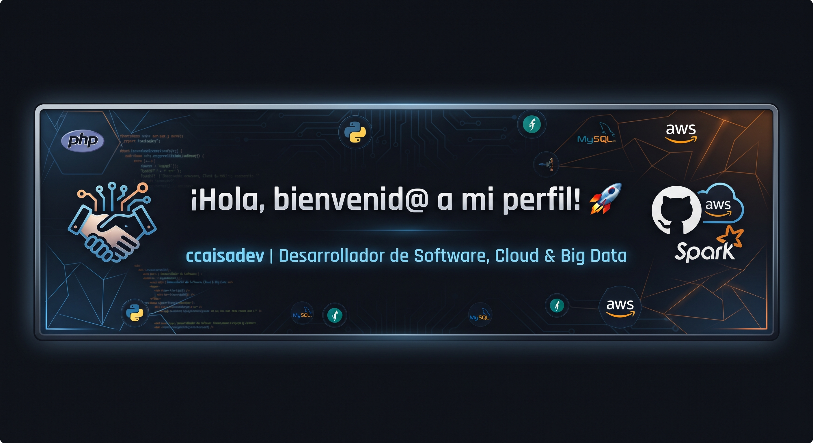

  

  
  

---

### 💻 Sobre mí
Desarrollador Full-Stack especializándome en Big Data e Inteligencia Artificial, busco transformar problemas complejos en código limpio, escalable y soluciones inteligentes basadas en datos.

Mi trayectoria es atípica y es mi mayor fortaleza: vengo de una sólida base universitaria en Química e Ingeniería que forjó mi pensamiento analítico, y de varios años de experiencia real gestionando negocios propios y liderando equipos bajo presión. Este bagaje me permite no solo escribir código o entrenar modelos, sino entender el impacto real que tiene la tecnología en el cliente y en los procesos de la empresa.

Actualmente, mi stack principal abarca el desarrollo frontend/backend (HTML5/CSS3, JavaScript, Python, SQL), la ingeniería y procesamiento de datos en la nube (AWS S3, Apache Spark, AWS Glue, Athena, Power BI) y el desarrollo de soluciones de Inteligencia Artificial —desde modelos predictivos de Machine Learning (Amazon SageMaker, scikit-learn) hasta arquitecturas de IA Generativa y agentes conversacionales en AWS (Amazon Bedrock)—, trabajando sobre Git, GitHub y Linux.

Siempre estoy aprendiendo algo nuevo y busco integrarme en un equipo donde pueda aportar valor técnico y estratégico desde el primer despliegue.

---

### 🛠️ Tecnologías y Stack Destacado

#### 🌐 Lenguajes y Backend

  
  
  
  

#### 🎨 Frontend & Estilos

  
  

#### ☁️ Cloud, Big Data, IA & Bases de Datos

  
  
  
  
  

#### ⚙️ Herramientas & Control de Versiones

  
  

---

### 🚀 Proyectos Destacados

  

<em>🛠️ Actualmente estoy desarrollando y puliendo nuevos proyectos orientados a desarrollo, IA y Big Data que publicaré muy pronto por aquí. ¡Mantente atento!</em>

---

### 📊 Estadísticas de GitHub

  

---

### 📬 Conectemos

  <a href="https://instagram.com/carlos.coder" target="_blank">
    

  

